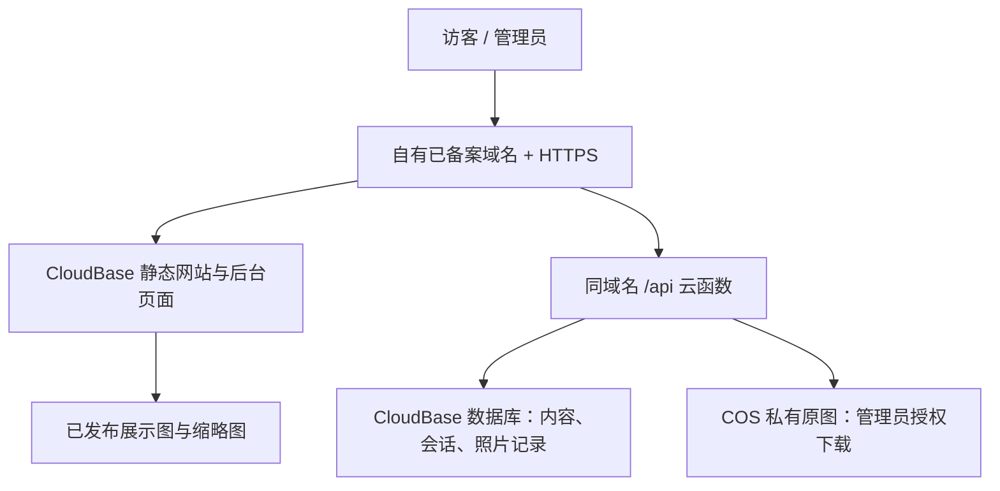

# 摄影网站云端部署与照片存储方案

## 本轮 KV 展示副本（2026-10-29）

当前正式站采用 **Cloudflare Pages + D1 + 私有 Backblaze B2 + KV 展示副本**。Production部署 `da72114c`（源码 `244067c`）及 `displayProvider: cloudflare-kv` 已线上读回；原图保留私有B2，网页展示图和缩略图复制到KV，通过原有媒体URL读取，发布状态与引用仍先由D1检查。本轮不改CMS、不删除B2文件、不启用付费服务或修改账户caps。

现有97组完整上传的194份展示图/缩略图已完成复制和完整SHA读回，文件合计83,447,923 B，含键余量台账占用83,845,235 B；8条匿名图片正文均从KV实际返回，三个页面HTTP200，CMS version36及内容指纹未变，匿名原图401。详细范围见[本轮交接](../40_测试与验收证据/阶段交接/KV展示副本启用_kv-display-enablement_2026-10-29.md)。网站为KV配置800,000,000 B容量预算（含2048 B/键余量），每日最多800次写入尝试；新上传保留既有B2三角色文件，副本失败可恢复，不重新上传已确认的原图。

Cloudflare官方Free额度是KV账户1GB、每日100,000次读取/1,000次写入，另有Workers账户每日100,000请求；当前所有页面、静态文件、API与图片都经过Worker，共享这一请求额度。预算不是账户实时余额，也不是无限访问。额度耗尽时不同IP同样受影响，日额度于00UTC（北京时间08:00）重置；KV传播可能需要60秒或更久。与旧B2账户截图限额的比较不能解释为固定访客倍数。参见[KV定价](https://developers.cloudflare.com/kv/platform/pricing/)、[Workers限制](https://developers.cloudflare.com/workers/platform/limits/)、[KV一致性说明](https://developers.cloudflare.com/kv/concepts/how-kv-works/)（本轮核验2026-10-29）。

## 以下为原部署与选型历史

初次资料核验日期：2026-10-24；本轮实施完成日期：2026-10-25（Asia/Shanghai）。当前免费路线为 Cloudflare Pages + D1 + 私有 Backblaze B2，正式入口 https://wong-photography-4a45fb46.pages.dev/Home/ ，后台为同域 /admin/ 。现有CMS、统计和23个上传媒体已迁移，原图与展示图分离；后台可直接选图上传，不需要本地文件夹。50 MB生成原图真实云端链路、9 MB真实浏览器流程、十项桌面/手机布局及用户本次大陆手机流量的正式首页/摄影页/照片验证已通过。未来最多1,000张能否全部装下仍取决于实际字节；网站限制9 GB，桶免费限额保持原设置。


> 2026-10-25正式续接：Pages/D1/私有B2正式站已发布，50 MB真实云端链路10项通过；上传恢复修复通过23项后端测试及5种浏览器模拟故障验收。现有CMS和23媒体已按备份及路径映射迁入，69个三角色文件哈希与24处引用映射通过。部署不再以本地原图文件夹为前提，后续从正式后台选图即可直接上传。以下选型/预检按历史阶段保留，当前进度以[会话移交](../40_测试与验收证据/阶段交接/云端部署会话移交_cloud-deployment-thread-handoff_2026-10-25.md)为准。

## 选择建议

原免费候选为 **Oracle Cloud Always Free 虚拟机 + SQLite + DuckDNS**。用户现已确认只有银联银行卡、微信和支付宝，且注册付款页出现请求超限；尚无官方确认可用的付款验证方式。因此 Oracle 不再作为当前执行主路线，不能继续将注册作为用户下一步必做事项。免费部署目标仍有效，改为先核实免国际银行卡的服务、原图实际总量与最终域名可达性。

当前只执行免费路线。后文 **腾讯 CloudBase 上海个人版 + COS 上海照片存储 + 自有已备案域名** 保留为费用比较依据，尚未获得购买授权，不充值、购买或订阅。任何部署继续保留现有网站外观、文案、作品结构与后台操作方式。

## 已核实的项目起点（2026-10-24 当时状态）

- 当前 `GET /api/cms-status` 返回 `storage: local-server`、`version: 44`。当前内容存入本机共享文件，不能由此认定互联网已有共享数据库。
- `20_源码与运行工程/.local-db/wong-cms.json` 当前 99,175 字节；上传目录有 21 个文件，共 22,119,611 字节。这些是当前本地文件统计，不代表未来原图总量。
- `20_源码与运行工程/site-deployment/worker/index.js` 已有管理员会话、内容版本校验、数据库与对象存储接口；它是 Cloudflare Worker 工程，迁移腾讯或普通虚拟机需要适配运行时和存储接口。
- 现有云端上传接口仅接收 JPEG、PNG、WebP、GIF，单文件不超过 8,000,000 字节。较大 JPEG、RAW 与断点续传尚需补充。
- 当前云端内容整体 JSON 保存上限为 1,000,000 字节。1,000 张照片增加元数据后须实测序列化体积；超过上限时按照片记录拆分，图片字节始终独立存储。
- 本地服务限制本机来源，含本地开发登录配置。正式版需独立生产入口与凭据配置；不能仅把监听地址改成公网地址便视为上线完成。
- 本次开始时根仓库已有其他页面与说明文件的未提交修改。方案不改动这些文件。

## 照片空间怎么算

数据库保存名称、分类、排序、发布状态、图片路径等；照片文件放对象存储或云端持久化磁盘。数据库的免费 GB 数不能直接算成照片空间。

以下按每张展示图 0.8 MB、缩略图 0.1 MB 估算；这两个数是设计假设，需以真实导出图校准。按十进制近似计算，不含历史版本及额外备份。

| 平均每张原图 | 1,000 张原图 | 展示图与缩略图 | 合计约需 |
| --- | ---: | ---: | ---: |
| 5 MB | 5 GB | 0.9 GB | 5.9 GB |
| 15 MB | 15 GB | 0.9 GB | 15.9 GB |
| 20 MB | 20 GB | 0.9 GB | 20.9 GB |
| 50 MB | 50 GB | 0.9 GB | 50.9 GB |
| 80 MB | 80 GB | 0.9 GB | 80.9 GB |

用户最新补充：多数原图为 **JPEG，每张约 5–15 MB，单张可能接近 50 MB**。按 1,000 张和每张 0.9 MB 派生图估算，总量约 **5.9–15.9 GB**；若很多照片接近 50 MB，实际总量会更高。此前 100 GB 是保守规划，不是用户硬性要求或必购容量。若原图与派生图全部存到新平台，可先按 **20–25 GB** 的候选空间筛选，最终以实际文件总字节和备份余量决定；免费 10 GB 不能保证容纳全部 1,000 张。网站只向访客加载展示图，原图默认私有；后台授权原图下载已通过正式云端和浏览器验证，匿名原图请求被拒绝。

### 原图下载到本地后：只读盘点

2026-10-25 用户明确要求：不对接百度网盘，也不继续核实网盘官方接口；用户会自行把原图下载到本地电脑。此前“沿用现有云盘作为网站原图库”的候选路线撤销，不研究、不登录或调用网盘。原图和展示图都保存、原图私有的目标继续保留，不能借此改成只在本地保管原图。

下载完成后，使用零依赖脚本 [照片容量盘点](../20_源码与运行工程/云端迁移_cloud-migration/照片容量盘点_photo-capacity-audit.mjs) 读取指定文件夹内 JPEG 的数量、总字节、最大单文件，以及超过当前 8 MB 上传门槛和保守十进制 50 MB 门槛的数量。它只读取目录与文件元数据，跳过符号链接和目录联接，不解码、修改、压缩或上传照片。报告采用新建模式，拒绝覆盖已有报告，也拒绝写入原图文件夹。

在项目根目录执行下面命令；示例路径需换成实际下载完成的原图目录：

```powershell
node "./20_源码与运行工程/云端迁移_cloud-migration/照片容量盘点_photo-capacity-audit.mjs" --source "D:/照片/原图"
```

默认按每张 900,000 字节派生图、10 GB 总空间预留 1 GB 测算；可用 `--capacity-gb` 和 `--reserve-gb` 改变测算容量。complete 仅表示没有读取错误，被跳过链接中的照片不计入统计。它假设目标云账号尚无其他占用，结果只用于选型，不能代替免费资格、超额保护、文件内容完整性和大陆访问验收。需要独立 JSON 清单时，用 `--output` 指向原图目录外、尚不存在的绝对报告路径；含相对文件名的清单只在本机保存。

原图独立备份的建议继续保留，但下载尚未验证，不能声称已有本地原图副本。此前的 CMS 与媒体备份不包含未下载的百度网盘原图。当前不需要等待原图才能复核网站构建与非隐私样本部署；现有23个网站上传媒体已完成迁移；额外原图可日后从网站后台选择上传，批量盘点不是部署前提。

## 原路线一：Oracle 免费方案（当前付款准入未满足）

| 部分 | 具体选择 | 限制 |
| --- | --- | --- |
| 网站与后台 API | Oracle Always Free 虚拟机，Node.js 生产服务与 HTTPS 反向代理 | 自行维护，需先成功申请免费规格 |
| 公共地址 | 自选名称的 `*.duckdns.org` 免费子域名 | 不是自己持有的独立域名；最终名称与解析 IP 的大陆访问尚未实测 |
| 数据库 | 自建 SQLite，放持久化磁盘，保留版本冲突检查 | 不额外购买托管数据库；备份与恢复由项目负责 |
| 原图与展示图 | Always Free 块存储中的独立持久化目录 | 总免费块存储 200 GB 包含系统盘；可规划 50 GB 系统盘 + 150 GB 数据盘，其中照片先限额 100 GB |

Oracle 官方列出 200 GB 免费块存储及每月 10 TB 出站数据额度；它与独立对象存储的免费 20 GB 是不同产品。超出网络额度或创建额外付费服务不在零费用设计内。免费计算资源可能缺货，闲置实例可能被回收，账户注册需要可接受的银行卡验证。只选标记 Always Free eligible 的资源，不能把 30 天试用金当作长期免费额度。参见 [Oracle 免费资源](https://docs.oracle.com/en-us/iaas/Content/FreeTier/freetier_topic-Always_Free_Resources.htm)、[注册与账户条件](https://www.oracle.com/cloud/free/)、[DuckDNS 官方说明](https://www.duckdns.org/faqs.jsp)。

实施顺序：先检查可申请地域与免费资源，再在用户授权后创建无私人数据的验证站；分别验证大陆电信、联通、移动普通网络下的域名解析、HTTPS、后台登录和样片浏览。通过后才进入正式数据迁移。资源申请失败或大陆访问不合格时，保留本地系统，重新选路，不先上传全部原图。

SQLite 版需要复用现有业务规则，适配 Worker 的 D1/R2 接口。照片目录按原图、展示图、缩略图分开；上传采用流式/分片接收与失败重试，不一次性把大批原图读入服务内存。免费虚拟机、DDNS 及单机磁盘都不等于无人维护或免备份。

## 路线二：大陆正式站优先，接受少量持续费用



建议选 CloudBase 上海云数据库环境与同地域 COS。通过 HTTP 网关把网页与 `/api/*` 映射到同一域名，保留现有 Cookie 会话及接口契约，减少前端改动。数据库可采用文档型存储；需保留条件写入以防多人覆盖，访问统计继续独立存储。照片上传由后端签发限时、限对象权限，浏览器分片直传 COS，永久密钥只保存在服务端。参见 [CloudBase HTTP 访问与路由](https://cloud.tencent.cn/document/product/876/130728)。

| 成本项 | 核验结果与估算 |
| --- | --- |
| CloudBase 网站/API/数据库 | 个人版当前限时优惠 19.9 元/月，含每月 40,000 资源点；这些能力共用点数，超量可能额外收费，不能承诺永远此价 |
| COS 100 GB 标准单 AZ 存储 | 按广州示例刊例 0.118 元/GB/月计算，存满约 11.80 元/月；实际选择上海时应再次核对地域价格与可用资源包 |
| COS 公网直读流量 | 官方示例 0.5 元/GB；若月下载 10 GB，约 5 元；与已购买的存储容量分开计费 |
| 域名 | 自有域名按注册和续费价格另计；免费 DNS 解析不代表域名注册免费 |
| 请求、网关、处理与额外加速 | 按各产品规则核算。启用 CDN 后同时评估分发与回源费用，不把它们算成存储包已含 |

示例基础费用约 **31.70 元/月 + 域名 + 下载流量及其他未抵扣资源费**；10 GB COS 公网直读对应约 36.70 元/月再加其余费用。以上是公式测算，不是报价或固定封顶。来源：[CloudBase 当前价格](https://cloudbase.net/pricing)、[COS 官方成本示例](https://cloud.tencent.com/document/product/436/50201)、[COS 实时价格页](https://buy.cloud.tencent.com/price/cos)、[COS 流量规则](https://cloud.tencent.cn/document/product/436/53863)。

生产 CloudBase 需自有已备案域名。如果用 CloudBase 申请备案，官方要求个人版及以上、备案期间剩余有效期大于 6 个月，并开启云托管固定 IP；它与云函数固定出口 IP 是不同能力。购买前需在实际账户确认该功能能否开通、备案控制台是否识别该环境及具体费用。上面的基础费用不包含尚未确认的固定 IP/备案资源附加费用，也不代表只需支付一个月即可完成备案。参见 [CloudBase 备案 FAQ](https://cloud.tencent.com/document/faq/876/128405)、[备案云资源要求，更新于 2026-10-16](https://cloud.tencent.com/document/product/243/18908)。如果已有合适的备案域名和接入资源，则按实际接入要求核对。

数据库初期可用免费环境做验证，但它每月仅有 3,000 点且多种资源共用，需要手动续期；免费环境当前自定义域名配额为 0，不能直接当作本路线的正式生产套餐。参见 [资源点与套餐限制，更新于 2026-10-21](https://cloud.tencent.com/document/product/876/127357)。

## 常见免费方案为什么没有直接选作主方案

| 平台 | 本次核验的关键限制 |
| --- | --- |
| Cloudflare Workers + D1 + R2 | 与现有云端工程匹配度高。D1 免费单库 500 MB、账户合计 5 GB；R2 Standard 免费 10 GB-month/月，含有限读写操作、出网流量免费。若平均原图很小可容纳 1,000 张，但较大原图会超额，R2 超量计费。大陆访问须实测；中国大陆网络产品需企业套餐另购，不能把全球免费服务视为大陆加速 |
| 腾讯 EdgeOne Pages | 默认域名：含大陆区域使用有效 3 小时的预览链接；不含大陆区域的默认域名在大陆网络返回 401。正式访问需自定义域名 |
| 阿里 ESA Pages | 默认公共域名为测试用途，需要有效 60 分钟的 token；正式入口需绑定已有域名 |
| Supabase Free | 免费数据库 500 MB、文件存储 1 GB；闲置一周项目会暂停。文件空间不适合作为此需求的原图库 |

来源：[D1 限制](https://developers.cloudflare.com/d1/platform/limits/)、[R2 价格与操作额度](https://developers.cloudflare.com/r2/pricing/)、[R2 开通要求](https://developers.cloudflare.com/r2/get-started/)、[Cloudflare 中国网络](https://developers.cloudflare.com/china-network/)、[EdgeOne 域名规则](https://edgeone.cloud.tencent.com/pages/document/175191784523485184)、[ESA 测试域名](https://help.aliyun.com/zh/edge-security-acceleration/esa/user-guide/create-pages-from-a-template)、[Supabase 价格](https://supabase.com/pricing)。R2 的 `r2.dev` 地址官方也仅建议非生产使用；生产图片可通过网站自己的媒体接口或自定义图片域名提供，参见 [R2 公共桶](https://developers.cloudflare.com/r2/buckets/public-buckets/)。

## 后续实施与验收

1. **容量盘点**：用户自行下载原图到本地后，使用上述脚本只读统计指定目录；不对接或核验百度网盘接口。按真实总量、派生图估算和备份余量判断免费空间是否足够。只生成独立展示副本，不修改原图。
2. **备份和迁移演练**：备份当前 CMS、统计数据、媒体与路径清单，记录哈希。将现有记录 ID、顺序、分类、草稿与发布状态映射到云端；检查旧路径，保留兼容或建立明确映射。
3. **生产适配**：保持页面风格与现有后台操作；补充较大原图上传、分片重试、私有原图、服务端认证和 HTTPS。发布前按当前代码验证公开内容过滤、留言与管理权限，不沿用过期审计结论。
4. **访问验证**：大陆三运营商普通网络分别检查最终域名的首页、作品图、后台登录/保存、原图上传与授权下载；验证 CSS、JS、字体与外部资源，不只检查首页 HTTP 200。
5. **跨设备与持久化**：电脑后台修改后，另一部手机能读取同一份云端数据；关闭本机电脑后网站继续运行；云服务重启后内容和原图仍在。检查一个真实原图的上传、下载哈希。
6. **恢复与额度**：演练数据库导出恢复和一张照片恢复；明确空间、请求、流量的告警和超额行为。告警本身不等于账单硬上限；未启用付费的资源按官方限额停用规则处理。

已完成的本地检查与资料选型不代表云端验收。按用户既有授权，继续免费范围内的准备与非隐私样本验证，通过后再迁移部署；支付、订阅或降低原图保存要求不在当前执行范围内。Cloudflare 登录、用户控制台 Free 套餐确认及独立测试资源创建已完成；Pages 已通过用户中国移动网络实测；其他运营商访问、足够免费原图空间和真实照片迁移仍未完成。
## 免费路线执行进度（2026-10-25）

用户已选择免费方案，采用原图私有、展示图公开的保管方式，并授权在可行性验证通过后迁移部署。Oracle 付款验证条件与现有支付方式不匹配；**Cloudflare 账号准入及 Pages 中国移动访问验证已完成；足够免费原图空间、其他运营商访问和正式网站迁移仍未验收，真实照片尚未上传**。

2026-10-24 的历史准备：当时 CMS/统计/21 个已上传媒体的独立本地备份（合计 23 文件，逐项 SHA-256 校验）；现有云端工程构建通过；Worker 接口与真实 SQLite 统计共 11 项定向测试通过；81 个构建文件已按清单保存独立副本。本机到 Oracle 控制台、注册页和 DuckDNS 官网的 HTTP 预检均收到 200，但这不能代替最终域名的大陆三网实测。原有源码和未提交页面改动保留。

当前下一步：Oracle 的付款验证准入未满足，不再要求用户继续注册。用户只有银联、微信、支付宝，多数原图 JPEG 约 5–15 MB、单张约 50 MB 以内；用户将自行从百度网盘下载到本地，已明确禁止继续网盘接入研究。容量盘点工具已完成合成文件验证，真实原图目录和总量仍待下载后确认；不能用网站当前的小尺寸上传图代替原图统计。

### 免国际银行卡的替代选型核验

| 候选 | 当前核验结果 | 对本需求的结论 |
| --- | --- | --- |
| Cloudflare Workers/D1 + Backblaze B2 | B2 官方提供免信用卡注册及前 10 GB 免费存储；私有桶通过鉴权 API 读取。首次创建公开桶另有付款验证要求，不能把所有桶模式都说成免卡 | 可作小规模候选，但 10 GB 不能保证装下全部照片；正式网站后台与全部照片容量未验收；独立Pages/B2样本代理电脑侧通过，新增图片及原图保护的中国移动手机实测通过，其他运营商未测 |
| 七牛 Kodo | 实名后有持续 10 GB 免费标准存储；默认测试域名 30 天回收，正式域名另配；HTTPS CDN 流量不在其 HTTP 免费流量内 | 仅存储局部免费，不是完整免费大陆站点 |
| DBByte | 官方定价页称免卡 20 GB；docs 明确超流量按 $0.01/GB 收费，未核实免费档硬停或禁止计费；REST 上限 50 MB 未说明准确字节数 | 暂不符合严格零费用的准入要求。签名下载文档存在状态差异，功能、数据恢复与大陆可达性也未实测；不注册或上传真实原图 |
| IDrive e2 | 注册页称 Free Trial；未核实当前长期免卡 10 GB 承诺，条款允许调整免费账户 | 不纳入已确认长期免费方案；不能用普通 IDrive Basic 备份产品的免费条件替代 e2 S3 条件 |
| 国内 CloudBase/COS 等 | 腾讯云支持微信及网银；阿里云支持支付宝、银联借记卡等国内渠道 | 支付方式匹配，但正式域名、备案及持续资源费用仍需核算。用户尚未授权改为付费路线，不充值、不购买 |

本轮开始时旧 Cloudflare OAuth 需要重新登录。设备码流程失败后，已通过官方浏览器 OAuth 成功登录；用户确认 Workers 套餐显示 Free，并明确同意增加 Pages 管理权限后完成追加授权。未输出令牌值、添加付款方式或执行付费。临时 Wrangler 4.152.0 与缓存位于项目 99 目录，未修改项目 package.json 或依赖锁文件。

替代选型依据：[B2 免信用卡注册](https://www.backblaze.com/sign-up/cloud-storage)、[B2 私有桶与公开桶条件](https://www.backblaze.com/docs/cloud-storage-deliver-private-backblaze-b2-content-through-cloudflare-cdn)、[B2 官方免费容量说明](https://www.backblaze.com/blog/go-serverless-with-rising-cloud-and-backblaze-b2/)、[七牛免费额度](https://developer.qiniu.com/af/12968/freequota)、[七牛域名限制](https://developer.qiniu.com/kodo/12957/kodo-nomarl-faq)、[DBByte 价格](https://dbbyte.com/pricing)、[DBByte API](https://dbbyte.com/api-reference)、[IDrive e2 条款](https://www.idrive.com/s3-storage-e2/terms)、[腾讯云国内充值方式](https://cloud.tencent.com/document/product/555/7425)、[阿里云充值方式](https://help.aliyun.com/zh/user-center/add-funds/)。

当前下一步：新的 Pages 地址已在同一中国移动手机流量网络验证页面、图形和数据库均正常。保留该稳定项目地址继续验证存储与正式后台；电信、联通仍待实际使用网络验证，不把一次移动测试扩大成全国访问保证。用户原图下载完成后再提供本地目录进行只读统计；不再询问网盘容量或研究其接口。免费额度、正式公开访问与原图私有三项分别验收，B2 的 10 GB 仅是小样候选，不能默认满足全部 1,000 张。

2026-10-25 已用当前版本在项目 99 目录的独立副本重新构建：81 个客户端文件与 Worker 打包成功，现有 Worker/真实 SQLite 定向测试 **13 项通过、0 失败**；原独立部署仓库未修改。这些构建及 13 项测试仍是本地验证；另行完成的独立云端样本验证见下文，50 MB 原图上传及私有原图下载仍未实现或验收。容量工具的合成文件检查通过，真实原图未读取。详见 [本轮交接](../40_测试与验收证据/阶段交接/免费部署准备交接_free-deployment-readiness-handoff_2026-10-25.md)；历史备份见 [免费云端部署预检记录](../40_测试与验收证据/免费云端部署预检_free-cloud-preflight_2026-10-24_待验证-unverified.md)。
2026-10-25 补充依据：[DBByte 超额与功能状态说明](https://dbbyte.com/docs)、[Workers 免费额度](https://developers.cloudflare.com/workers/platform/pricing/)、[免费 workers.dev 域名规则](https://developers.cloudflare.com/workers/configuration/routing/workers-dev/)。Pages 中国移动访问这一项已有实际验证；免国际卡的足够原图空间、严格零费用保护及完整后台仍需后续验证。

### 独立云端连通实测（2026-10-25）

- 已部署 [非隐私验证程序](../20_源码与运行工程/云端迁移_cloud-migration/云端连通预检_cloud-connectivity-preflight.mjs)，仅提供固定中文页面、CSS、生成的 SVG、健康接口和单条 D1 标记读回；拒绝写入接口。未读取或上传本地正式 CMS、用户照片、原图或账号资料。
- Cloudflare 测试 Worker 和测试 D1 各一个；Pages 为独立新增项目，复用同一测试库，未改动账号原有的其他 Pages 项目。未开通 R2、Workers 付费或其他订阅。

| 入口 | 当前电脑 HTTP/数据库实测 | 用户大陆普通网络实测 | 结论 |
| --- | --- | --- | --- |
| [Worker 验证站](https://photo-cloud-preflight-20261025-bc4407.photo-cloud-bc4407.workers.dev/) | 页面、资源、健康接口、同一 D1 标记及 HEAD/404/405 检查通过 | 中国移动手机流量、关闭 Wi-Fi 和代理：打不开或报错 | 该地址不符合用户当前访问条件，不迁移真实数据 |
| [Pages 验证站](https://photo-cloud-preflight-20261025-bc4407.pages.dev/) | 8 类检查通过；页面、生成图形及云数据库读回正确，与 Worker 使用同一测试标记 | 用户确认：中国移动手机流量，关闭 Wi-Fi 和代理；页面、图形及数据库 ok:true 均正常 | 中国移动本次连通验证通过；电信、联通及正式后台尚待实测 |

当前电脑网络路径未能确证，不能用这些 HTTP 200 替代大陆三网验收。Worker 初次 Node TLS 请求失败、后续原生 Windows curl/PowerShell 和 Node 请求成功，失败证据保留；未修改系统网络。Pages 初次数据库断言失败是本地预期记录经 PowerShell 转换了时区文本，原始 D1 时间与返回值始终一致；已改用原始 JSON 字符串复核，未修改数据库。

已取得登录与免费测试资源不代表完整方案可用：实际原图总量仍未知，10 GB 候选可能不足，当前正式后端仍需适配私有原图与较大上传。若 Pages 大陆访问失败，免费外部子域名只能作为下一轮候选；其长期条款、CNAME、证书和最终网络可达性仍须逐项核实。

部署与原始验证证据存于项目 99 目录，汇总和恢复入口见 [同一阶段交接](../40_测试与验收证据/阶段交接/免费部署准备交接_free-deployment-readiness-handoff_2026-10-25.md)。官方依据：[Pages 高级模式](https://developers.cloudflare.com/pages/functions/advanced-mode/)、[Pages D1 绑定](https://developers.cloudflare.com/pages/functions/bindings/#d1-databases)、[Pages 自定义域名](https://developers.cloudflare.com/pages/configuration/custom-domains/)。

### 照片存储接入前的免费准入（2026-10-25）

用户确认原图尚未下载完成，当前不读取或上传原图。B2 注册曾提示请求过多，现已由用户确认注册成功，并提供 Caps & Alerts 实际截图。用户已创建指定私有桶并把7天、仅限该桶的应用密钥保存到本地忽略配置；真实API只读核验及675字节生成样本的上传/认证回读/匿名拒绝均通过，没有读取或上传真实照片。

B2 官方确认前 10 GB 长期免费。现已从用户实际账户截图读取：存储费用上限 $0.00（10 GB），每日下载费用上限 $0.00（1 GB），Class B 和 C 每天各 2,500 次；截图当时已用存储与下载为 0、B 为 0 次、C 为 1 次。截图未显示 Class A 或付款方式，不编造其值，也不调整已显示的限额。cap 是阻止操作的限制，告警只是提醒；修改可能需要最多 10 分钟生效。

本轮仅在新建的指定私有桶中完成极小生成样本验证，没有创建公开桶、启用 Event Notifications、删除对象或修改费用限制。使用仅限该桶、7天有效的读写应用密钥；密钥由用户写入99目录的本地私有配置，不发聊天、不输出或提交Git。预检默认只读；样本写入需显式启用并附24小时内人工费用上限记录。

存储验证通过后按以下范围接入，保持现有网站界面和后台操作：

| 能力 | 现状 | 下一步验证 |
| --- | --- | --- |
| 网站及数据 | Pages + D1 仅有无隐私样本；移动本次访问通过 | 接入现有后台前验证生产认证、状态版本及跨设备保存 |
| 公开展示图 | 正式 Worker 目前使用 R2 BUCKET，并提供 /media/ 路径 | 独立B2样本代理已通过电脑侧云端检查；正式业务仍须适配私有桶及仅公开派生图的路径规则 |
| 原图 | 现有接口单文件上限 8,000,000 字节；没有云端私有原图库 | 原图独立路径，管理员鉴权下载，禁公共缓存；验证匿名拒绝和授权下载哈希 |
| 较大 JPEG | B2 普通文件上限 5 GB，50 MB 在其范围内；不等于本站已支持 | Native 上传要求准确 Content-Length、不支持 chunked；实现后验证流式/限额、失败恢复及 50 MB 边界 |
| 容量与费用 | 10 GB 不能保证容纳 1,000 张 5–15 MB 原图及派生图 | 下载后只读盘点；计入旧版本、重复对象、未完成分片、现有占用与余量；免费不足时不迁移全量 |

普通 B2 出口有额度和超额价格；官方 B2 到 Cloudflare 的免费传输条件不代表任何直接原图下载都无限免费。2026 当前价目对未付款账户仍保留操作硬限额，本次只将截图明确的 B/C 各 2,500 次用于该账户，不推广为所有账户或所有操作的固定值。若账户界面要求付款或无法核实零费用保护，只暂停存储写入，保留已通过的 Pages/D1 结果。

官方依据：[免卡注册](https://www.backblaze.com/sign-up/cloud-storage)、[现行定价](https://www.backblaze.com/cloud-storage/pricing)、[费用上限机制](https://www.backblaze.com/docs/en/cloud-storage-data-caps-and-alerts)、[设置费用上限](https://www.backblaze.com/docs/cloud-storage-create-and-manage-caps-and-alerts)、[私有桶与 Cloudflare](https://www.backblaze.com/docs/cloud-storage-deliver-private-backblaze-b2-content-through-cloudflare-cdn)、[上传协议](https://www.backblaze.com/apidocs/b2-upload-file)、[大文件与分片](https://www.backblaze.com/docs/cloud-storage-large-files)。

### B2 实际样本结果与网站接入准备

- [B2私有存储预检工具](../20_源码与运行工程/云端迁移_cloud-migration/B2私有存储预检_b2-private-storage-preflight.mjs)默认只读，真实API返回指定桶为allPrivate、密钥仅限该桶且有测试所需权限。
- 两张内存生成PNG合计675字节（原图角色424、展示角色251），每张上传200、认证下载200，长度/SHA-1/SHA-256一致；匿名下载均401。它们分别存于独立的随机新路径，保留未删除，不是用户照片。
- 首次上传400，依据官方X-Bz-Info字段百分号编码规则修复一行后，新路径复测通过；原失败记录保留。未取得首个400的安全错误细节，编码缺陷已确认但不声称是唯一原因。
- 已发行两个仅覆盖各自生成样本完整文件名前缀的24小时下载授权；Cloudflare Pages仅保存这些短期授权及样本保护测试密钥，用户填写的B2应用密钥仍只在本机。网站样本代理现已部署：展示角色公开读回200；原图角色未授权401、正确授权200且private/no-store，长度和SHA-256均匹配。仅有两张固定生成样本，不是正式照片库。
- 真实样本通过不代表50MB JPEG、正式CMS认证、全部原图容量、大陆三网长期可达性或费用硬停极限都已验收。本轮没有故意超过免费限额做破坏性测试。

官方编码依据：[Native API字符串编码](https://www.backblaze.com/docs/cloud-storage-native-api-string-encoding)；限定下载授权：[b2_get_download_authorization](https://www.backblaze.com/apidocs/b2-get-download-authorization)。详细结果与恢复路径继续维护在同一阶段交接。

### Pages 到 B2 样本链路完成（2026-10-25）

[样本代理源码](../20_源码与运行工程/云端迁移_cloud-migration/B2云端样本代理_b2-cloud-sample-proxy.mjs)只读取两张固定生成PNG，没有B2账户、上传或删除接口。主应用密钥保留本机；Pages Secrets只含各限样本文件名前缀的短期下载授权及原图角色HMAC验证密钥。下载授权约于 **2026-10-26 13:03（Asia/Shanghai）** 失效，不能把这次临时代理当作长期生产接入。

当前部署为 https://0656faaf.photo-cloud-preflight-20261025-bc4407.pages.dev ，[稳定验证地址](https://photo-cloud-preflight-20261025-bc4407.pages.dev/)不变。电脑侧11项真实云端检查全部通过：页面、健康接口、原D1标记、公开展示图及HEAD、原图角色缺失/错误授权拒绝、正确授权下载及HEAD、405与404；响应未发现所用秘密值。它不证明该电脑网络为大陆直连。用户随后确认同一中国移动手机流量、关闭Wi-Fi及代理：新增PNG能显示，原图保护提示authentication-required。本次该运营商样本链路通过；电信/联通、50MB上传及正式后台不在该验收范围。

最初代理503已保留失败记录。实际workerd运行时复现确认不支持redirect:error，改为manual并拒绝所有非200后真实云端通过；恶意302不跟随及不回显敏感内容的定向mock通过。基础代理20项、诊断7项、兼容修复6项是分阶段定向检查，存在重叠，不相加成独立用例总数；另有独立只读审查通过。实现依据为[Cloudflare workerd](https://github.com/cloudflare/workerd/blob/main/src/workerd/api/http.c%2B%2B)。

正式CMS、较大JPEG上传、长期生产认证、全部原图容量与真实照片迁移仍未完成。原图下载后先只读盘点；若10GB不足，不上传全量或降低原图保存要求。完整证据和恢复入口见[同一阶段交接](../40_测试与验收证据/阶段交接/免费部署准备交接_free-deployment-readiness-handoff_2026-10-25.md)。
